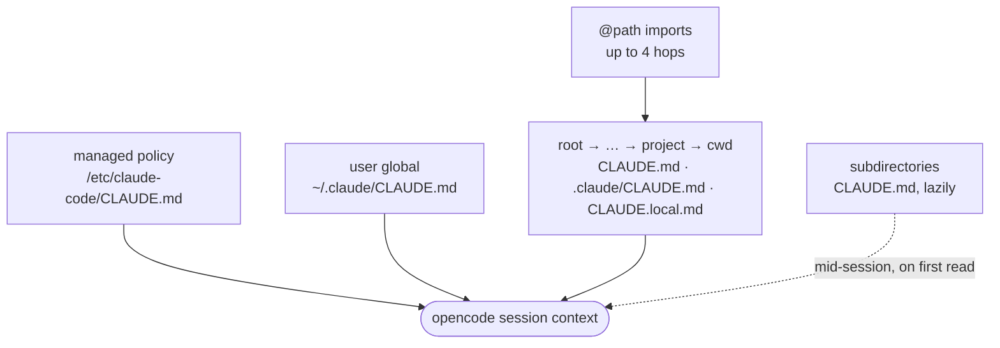

# CLAUDE.md for opencode


[](https://www.npmjs.com/package/opencode-claude-md)
[](https://www.npmjs.com/package/opencode-claude-md)
[](LICENSE)
[](https://opencode.ai/v2/docs/build/plugins/)

> **If Claude Code would read your `CLAUDE.md`, opencode reads it too.**

[opencode](https://opencode.ai) v2 reads `AGENTS.md` natively and never looks at `CLAUDE.md`. This plugin puts the whole `CLAUDE.md` family in front of the model, stacked exactly the way Claude Code would.

Move a project between Claude Code and opencode and your instructions follow: no half-loaded memory, no silent gaps.

<br clear="all">

## Features

- 📚 **Full hierarchy** from filesystem root down to your working directory, ancestors first
- 🌐 **User-global and managed-policy** files, on every OS
- 🔒 **`CLAUDE.local.md`** picked up at every level
- 🔗 **`@path` imports** expanded up to 4 hops deep
- 🪺 **Subdirectory `CLAUDE.md`** loaded lazily, as tools reach into each subtree
- ♻️ **Deduped** against opencode's own `AGENTS.md` pick, so nothing lands in context twice
- 🪶 **One file, no build step** (`index.ts` ships as TypeScript)

## What gets loaded

opencode v2 walks up from your working directory and loads every `AGENTS.md` it passes — up to the project root, or your home directory when the project sits inside it — plus one global `AGENTS.md` from its config directory, and nothing else. This plugin stacks the whole `CLAUDE.md` family around that.

| Instruction source | opencode native | opencode-claude-md |
|---|:---:|:---:|
| Every `AGENTS.md` project root → cwd (or home → cwd), and one global | ✅ | ✅ *(left to opencode)* |
| Every `CLAUDE.md` from root → cwd | ❌ | ✅ |
| `.claude/CLAUDE.md` at each level | ❌ | ✅ |
| `CLAUDE.local.md` at each level | ❌ | ✅ |
| `~/.claude/CLAUDE.md` (user global) | ❌ | ✅ |
| `@path/to/file` imports (≤ 4 hops) | ❌ | ✅ |
| Managed policy file (per-OS path) | ❌ | ✅ |
| Subdirectory `CLAUDE.md`, on first touch | ❌ | ✅ |



## Installation

Requires **opencode v2** — it is built on the [v2 plugin API](https://opencode.ai/v2/docs/build/plugins/migrate-v1/), whose default-export shape earlier releases do not load.

Install globally, for every project:

```sh
opencode plugin add opencode-claude-md
```

For one project only, add it to that project's `opencode.json`:

```json
{ "plugins": ["opencode-claude-md"] }
```

## Usage

> [!TIP]
> Restart opencode after installing so the plugin loads.

Ask opencode what it can see, no tools needed:

```
list all CLAUDE.md / AGENTS.md that you can see right now (without using tools)
```


## How it works

Content rides in every primary model request's system parts as a hidden `<system-reminder>` block: the main agent sees it on every call, and nothing is written into the session transcript. Per-file labels match Claude Code's ("project instructions, checked into the codebase", and so on).

Subdirectory files load later. When a tool reads, edits, or writes a file below your working directory, the plugin checks that path. Any new `CLAUDE.md` or `CLAUDE.local.md` it finds gets attached to the tool result, the way Claude Code delivers them.

After a `/compact`, subdirectory files re-attach on the next touch. Startup files need no re-inject step — they ride every primary request.

<details>
<summary><b>Safety, dedup, and import rules</b></summary>

A plugin can't show approval dialogs, so two guards stand in:

- **Confined imports.** An `@import` resolves only if its real target lives under the worktree, or under the importing file's own directory. Paths resolve through `realpath`, so symlinks can't cheat. Claude Code gates external imports behind a dialog; this plugin refuses them instead.
- **Escaped tags.** Any `<system-reminder>` tag inside file content gets escaped, so an instruction file can't forge or close the wrapper.

Two more details:

- **No duplicates.** The plugin skips whatever opencode's native loader already picked up: every `AGENTS.md` between your working directory and the project root (or your home directory), plus the global config `AGENTS.md`. Nothing reaches the model twice. It still expands those files' `@path` imports, though, since opencode's loader never does.
- **Comments stripped.** HTML comments are removed before injection.
- **Imports ignore code.** `@path` references inside fenced blocks, inline code spans, and indented code blocks (≥ 4 columns) are left alone.

</details>

## Alternatives

| Option | What it covers | Gap |
|---|---|---|
| opencode native rules | The `AGENTS.md` stack: every level up the tree + one global | No `CLAUDE.md` family, no `CLAUDE.local.md`, no `@import` |
| `instructions` array in `opencode.json` | Files you list by hand (globs, paths, URLs) | Maintained per project, ignores Claude Code's discovery rules |
| Symlink `AGENTS.md` → `CLAUDE.md` | One file per directory level | Only one file per level, and only under the `AGENTS.md` name |
| [opencode-claude-memory](https://github.com/kuitos/opencode-claude-memory) | Shares Claude Code's auto-memory dir | Different layer (memory the model writes). Runs fine alongside this plugin |

## FAQ

### How do I load CLAUDE.md in opencode?

Out of the box, opencode v2 reads `AGENTS.md` only — every one up the tree, but never any `CLAUDE.md`. Install this plugin to load the full hierarchy the way Claude Code does, at session start.

### Does opencode read AGENTS.md or CLAUDE.md first?

opencode v2 reads `AGENTS.md` — every one up the tree, plus the global one. `CLAUDE.md` is invisible to it. The plugin leaves opencode's `AGENTS.md` pick alone and stacks every `CLAUDE.md` around it.

### Does the plugin inject `~/.claude/CLAUDE.md`?

It is — always, under opencode v2. The v1-era native fallback to `~/.claude/CLAUDE.md` is gone, so the plugin delivers the user-global layer itself in every setup.

### Do `@path` imports in CLAUDE.md work in opencode?

Not natively. With this plugin they do: relative, absolute, and `~/` paths, up to 4 hops deep, same as Claude Code documents. Two conservative choices on top: imports inside code fences, inline spans, and indented code blocks are ignored, and targets outside the worktree (or the importing file's directory) are refused.

### Can instructions end up in the context twice?

No. The plugin skips opencode's native `AGENTS.md` picks, and its own block rides the system parts once per primary model request — requests are built fresh, so it never accumulates.

## Out of scope

- `.claude/rules/*.md` path-scoped rules.

## Development

The whole plugin is one file, `index.ts`, with no build step.

```sh
bun install
bunx tsc --noEmit
```

## Contributing

Issues and pull requests are welcome at [the repo](https://github.com/uwuclxdy/opencode-claude-md). Run `bunx tsc --noEmit` before opening a PR.

## License

MIT
